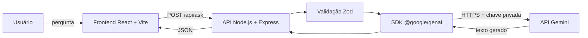

# Arquitetura do Google Fake



## Decisões

- A chave fica somente no backend e nunca é enviada ao navegador.
- A entrada aceita de 3 a 1.000 caracteres e é normalizada antes do envio.
- A API limita cada IP a 10 perguntas por minuto.
- O frontend exibe carregamento, falha de conexão, erro de configuração e resposta em Markdown.
- O serviço Gemini está separado da rota, permitindo testes sem consumir a API real.

## Contrato da API

`POST /api/ask`

```json
{ "question": "O que é inteligência artificial?" }
```

Resposta de sucesso:

```json
{
  "question": "O que é inteligência artificial?",
  "answer": "...",
  "model": "gemini-3.8-flash",
  "processingTimeMs": 842
}
```
